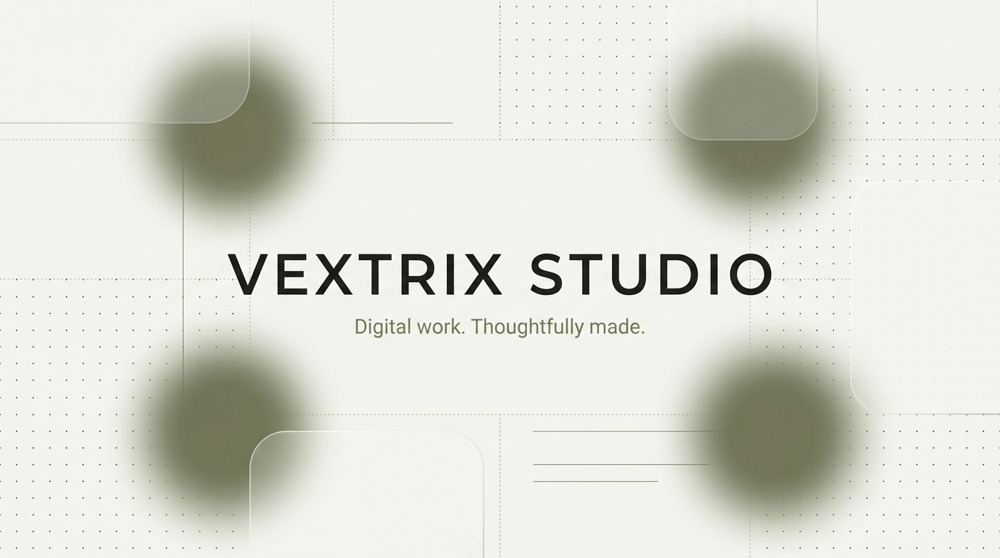

<div align="center">



### The official website of **Vextrix Studio**

An independent digital studio designing and building custom websites and web applications.
Perris, California · Remote worldwide · English / Español

&nbsp;


&nbsp;

[](https://vextrixstudio.vercel.app/)

**English** · [Español](./README.es.md)

</div>

---

> *Digital work. Thoughtfully made.*
> We design and build clear, credible websites and web applications that help people understand what you do, and take the next step.

---

## Contents

- [What is vextrixweb?](#-what-is-vextrixweb)
- [Features](#-features)
- [Pages & routes](#-pages--routes)
- [What the studio offers](#-what-the-studio-offers)
- [Tech stack](#️-tech-stack)
- [Project structure](#-project-structure)
- [Getting started](#-getting-started)
- [Scripts](#-scripts)
- [Design system](#-design-system)
- [SEO & metadata](#-seo--metadata)
- [Deployment](#-deployment)
- [The studio](#-the-studio)
- [License](#-license)

---

## What is vextrixweb?

`vextrixweb` is the official site of **Vextrix Studio**, an independent digital studio founded by **Jonatan A** in Perris, California.

The site introduces the studio and its work: what it builds, how it works, and how to start a project. It is intentionally small and sharp, three pages with a clear job each, an editorial monochrome look, and a strong focus on clarity, performance and accessibility. Fewer pages, more substance. Less noise, more intention.

## Features

- **Editorial monochrome design** — cream, warm gray, ink and sage tones, oversized display headlines and serif italic accents
- **Glassmorphism navbar** — floating pill navigation with backdrop blur, active-route states and an animated mobile menu
- **Accessible by default** — skip-to-content links, ARIA landmarks and labels, visible focus rings, `prefers-reduced-motion` support
- **SEO ready** — Next.js metadata API, Open Graph and Twitter cards, dynamic `sitemap.ts` and `robots.txt`
- **Contact form without a backend** — project type and budget selectors, browser validation, and a pre-filled email draft via `mailto:`
- **Scroll reveal animations** — IntersectionObserver-based entrance transitions with graceful fallbacks
- **Custom 404 page** — designed in the same visual language as the rest of the site
- **Fully responsive** — from mobile to ultrawide layouts, with touch-friendly targets and fluid `clamp()` typography
- **Typed & linted** — TypeScript 5 and ESLint 9 flat config

## Pages & routes

| Route | Page | Highlights |
|:-----:|------|------------|
| `/` | **Home** | Hero, services, 4-step process, studio principles, capabilities, contact CTA |
| `/about` | **About** | Studio story, philosophy, principles, scroll-reveal sections |
| `/contact` | **Contact** | Project inquiry form (type + budget) that opens a ready-to-send email draft |
| `*` | **404** | Custom "off course" page with a way back home |

## What the studio offers

| # | Service | Description |
|:-:|---------|-------------|
| 01 | **Custom websites** | A clear, credible home for your business, designed around your audience |
| 02 | **Web applications** | Useful digital products with thoughtful flows and complete states |
| 03 | **Landing pages** | Focused pages that explain one offer and guide the next step |
| 04 | **UI / UX redesign** | Clearer flows, stronger hierarchy and consistent components for existing products |

**How we work:** `Understand → Shape the experience → Build & test → Refine & launch`

## Tech stack

| Technology | Role |
|------------|------|
| [Next.js 16.4](https://nextjs.org) | App Router, file-based routing, metadata API, Turbopack |
| [React 19.3](https://react.dev) | UI components, hooks, client interactions |
| [TypeScript 5](https://www.typescriptlang.org) | Static typing across the whole codebase |
| [Tailwind CSS 4](https://tailwindcss.com) | Utility-first styling + `@tailwindcss/turbopack` |
| [ESLint 9](https://eslint.org) | Linting with `eslint-config-next` (flat config) |
| [Vercel](https://vercel.com) | Hosting and continuous deployment |

## Project structure

```
vextrixweb/
├── app/
│   ├── about/
│   │   └── page.tsx        # Studio story, philosophy & principles
│   ├── contact/
│   │   └── page.tsx        # Project inquiry form (mailto draft)
│   ├── globals.css         # Global styles & theme tokens
│   ├── layout.tsx          # Root layout + SEO metadata
│   ├── not-found.tsx       # Custom 404 page
│   ├── page.tsx            # Home: hero, services, process, studio, CTA
│   ├── robots.txt          # Crawler rules
│   └── sitemap.ts          # Dynamic sitemap (/ , /about , /contact)
├── components/
│   └── Navbar.tsx          # Glass navbar (desktop + mobile menu)
├── public/                 # Static assets (SVGs)
├── AGENTS.md               # Notes for AI coding agents
├── eslint.config.mjs       # ESLint flat config
├── next.config.ts          # Next.js configuration
├── package.json
└── tsconfig.json
```

## Getting started

### Prerequisites

- Node.js 20 or newer
- npm (a `package-lock.json` is included)

### Installation

```bash
# 1. Clone the repository
git clone https://github.com/VextrixStudio/vextrixweb.git
cd vextrixweb

# 2. Install dependencies
npm install

# 3. Start the development server
npm run dev
```

Open [http://localhost:3000](http://localhost:3000) in your browser. The page updates live as you edit `app/page.tsx`.

> Working with AI coding agents? Read [`AGENTS.md`](./AGENTS.md) before writing code, this project uses a Next.js version with breaking changes from older conventions.

## Scripts

| Command | Description |
|---------|-------------|
| `npm run dev` | Start the development server (Turbopack) |
| `npm run build` | Create an optimized production build |
| `npm run start` | Serve the production build locally |
| `npm run lint` | Run ESLint on the project |

## Design system

The visual language is quiet on purpose: neutral tones, generous whitespace and typography doing the heavy lifting.

| Token | Value | Use |
|-------|-------|-----|
| Cream | `#f7f7f4` | Primary page background (Home, 404) |
| Warm gray | `#e9e8e2` | Secondary page background (About, Contact) |
| Ink | `#20211e` | Text, buttons, logo tile, dark CTA panels |
| Sage | `#777b61` / `#73766a` | Accents, italic serif highlights, eyebrow labels |
| Sage light | `#e8eade` / `#dfe1d4` | Chips, selection color, soft fills |
| Glass white | `#ffffff` @ 55–85% | Cards and floating navbar with `backdrop-blur` |

**Typography:** oversized display headlines with `clamp()` sizing and tight negative tracking, serif italic accent lines, and small uppercase eyebrows with wide letter spacing.

**UI language:** rounded glass panels, pill buttons, soft layered shadows, and restrained hover motion (with `motion-reduce` fallbacks).

## SEO & metadata

- **Metadata API** in `app/layout.tsx`: title template (`%s | Vextrix Studio`), description, canonical URL, Open Graph and Twitter cards
- **`sitemap.ts`** generates `/sitemap.xml` for `/`, `/about` and `/contact`
- **`robots.txt`** allows indexing and following
- **Semantic HTML** with `aria-labelledby` section landmarks throughout

## Deployment

The site is deployed on **Vercel** at [https://vextrixstudio.vercel.app/](https://vextrixstudio.vercel.app/).

To deploy your own copy: push the repository to GitHub and import it at [vercel.com/new](https://vercel.com/new), Vercel detects Next.js automatically. Or use the CLI:

```bash
npm i -g vercel
vercel
```

## The studio

<table>
<tr>
<td width="50%" valign="top">

**Vextrix Studio** is an independent digital studio focused on building modern websites and web applications with thoughtful design, performance and clean development. You work directly with the person making your project.

</td>
<td width="50%" valign="top">

- **Founder:** Jonatan A
- **Based in:** Perris, California
- **Working:** remotely, worldwide
- **Languages:** English / Español
- **Email:** [vextrixstudio@outlook.com](mailto:vextrixstudio@outlook.com)
- **GitHub:** [github.com/VextrixStudio](https://github.com/VextrixStudio)

</td>
</tr>
</table>

**Principles:** `Purpose` — every choice supports the goal. `Clarity` — the message and next step are easy to understand. `Partnership` — direct communication with the person building your project.

## License

© 2026 Vextrix Studio. All rights reserved.

---

<div align="center">
  <i>Designed with intent. Built with care.</i><br /><br />
  <b>Vextrix Studio</b> · Thoughtfully built in Perris, California.<br /><br />
  <a href="https://https://vextrixstudio.vercel.app/">vextrixstudio.vercel.app</a> · <a href="mailto:vextrixstudio@outlook.com">vextrixstudio@outlook.com</a>
</div>
